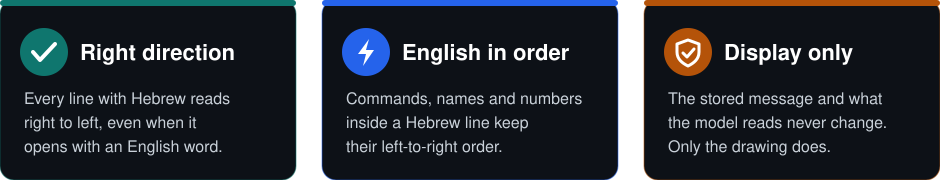

<div align="center">


# rtl-fix

**Hebrew, English and mixed text in Claude Code, finally in the right order.**

</div>

<p>
<a href="#install"></a>
<a href="#install"></a>
<a href="#how-it-works"></a>
<a href="LICENSE"></a>
</p>

<p align="center"></p>

|  | Before | After |
|---|---|---|
| A Hebrew line that opens with English | The words and punctuation jump around | The whole line reads right to left |
| `git status` inside a Hebrew sentence | Letters swap places | Stays `git status`, left to right |
| A Hebrew line in a code block | Garbled | Right to left, English kept in order |

<p align="center"></p>

<p align="center"></p>

## Install

In a terminal session of Claude Code, type at the prompt:

```text
/plugin install rtl-fix --marketplace EranTzarum/claude-rtl-fix
```

Answer `y` to add the marketplace, then pick a scope. From a shell instead:

```bash
claude plugin install rtl-fix --marketplace EranTzarum/claude-rtl-fix
```

In the desktop app, where `/plugin` does not run: click **+** next to the prompt box, then **Plugins**, **Add marketplace** with `EranTzarum/claude-rtl-fix`, then **Add plugin**.

Verify the install. Expected output:

```text
Installed rtl-fix. Plugin is now active.
```

Then send a message such as `הרץ את git status ובדוק ש-Claude Code עובד`. The English words keep their order inside a right-to-left line.

## Example

Input line in a reply:

```text
הרץ את git status.
```

What the mod hands to the screen (invisible marks shown as names):

```text
<RLM>הרץ את <LRI>git status<PDI>.
```

The line has a right-to-left base, and `git status` is an isolated left-to-right run, so the dot lands where a Hebrew reader expects it.

## How it works

The mod rewrites each Hebrew line before it is drawn, with an RTL base and isolated English runs. Details, and what it does not cover: [docs/how-it-works.md](docs/how-it-works.md).

## Develop

```bash
claude plugin validate .
claude plugin test .
```

The logic is one pure function, `fixBidi`, in `hooks/bidi.ts`. The hooks are in `hooks/register.ts`.

## License

[MIT](LICENSE)
